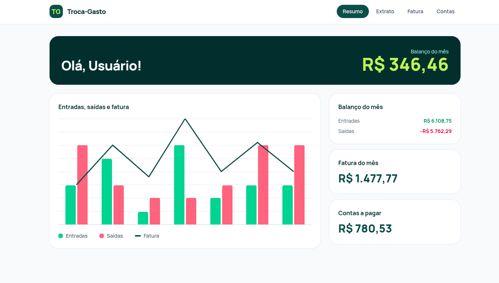

# TrocaGasto

É uma aplicação para acompanhamento de finanças pessoais com suporte a CSVs gerados pelo app Nubank.

O sistema exibe um panorama geral das finanças do usuário, incluindo movimentações no saldo da conta, compras no cartão e contas a pagar.



## Pré-requisitos

- Node.js 20 ou superior
- npm, yarn, pnpm ou bun
- Uma conta no [Supabase](https://supabase.com)

## Instalação

1. Clone o repositório e entre na pasta do projeto:

```bash
git clone https://github.com/analauraepa/troca-gasto.git
cd troca-gasto
```

2. Instale as dependências:

```bash
npm install
```

3. Configure o banco de dados no Supabase:

- Acesse o projeto no Supabase.
- Abra **SQL Editor**.
- Execute o seguinte script para criar as tabelas usadas pela aplicação:

```sql
create table if not exists public.extrato (
  user_id uuid primary key references auth.users(id) on delete cascade,
  records jsonb not null default '[]'::jsonb,
  updated_at timestamptz not null default now()
);

create table if not exists public.fatura (
  user_id uuid primary key references auth.users(id) on delete cascade,
  records jsonb not null default '[]'::jsonb,
  updated_at timestamptz not null default now()
);

alter table public.extrato enable row level security;
alter table public.fatura enable row level security;

create policy "Usuários gerenciam seu próprio extrato"
on public.extrato
for all
using (auth.uid() = user_id)
with check (auth.uid() = user_id);

create policy "Usuários gerenciam sua própria fatura"
on public.fatura
for all
using (auth.uid() = user_id)
with check (auth.uid() = user_id);
```

4. Crie os usuários de teste no Supabase:

- Acesse **Authentication > Users**.
- Clique em **Add user**.
- Crie pelo menos o usuário configurado como `userA` e, opcionalmente, o usuário `userB`.

A aplicação usa o login de teste definido em `src/config/test-user.ts`. Para o fluxo padrão, configure o usuário `userA` no arquivo de ambiente.

5. Crie o arquivo `.env.local` na raiz do projeto:

```bash
NEXT_PUBLIC_SUPABASE_URL=https://SEU-PROJETO.supabase.co
NEXT_PUBLIC_SUPABASE_PUBLISHABLE_KEY=SUA_CHAVE_PUBLICAVEL

NEXT_PUBLIC_TEST_USER_A_EMAIL=email-do-usuario-a@example.com
NEXT_PUBLIC_TEST_USER_A_PASSWORD=senha-do-usuario-a

NEXT_PUBLIC_TEST_USER_B_EMAIL=email-do-usuario-b@example.com
NEXT_PUBLIC_TEST_USER_B_PASSWORD=senha-do-usuario-b
```

Você encontra a URL e a chave publicável do Supabase em:

- **Project Settings > API**
- Use a URL do projeto em `NEXT_PUBLIC_SUPABASE_URL`.
- Use a chave publicável em `NEXT_PUBLIC_SUPABASE_PUBLISHABLE_KEY`.

Não coloque no repositório nenhuma chave secreta do Supabase ou senha real. O arquivo `.env.local` já está configurado para ser ignorado pelo Git.

## Executando o projeto

Inicie o servidor de desenvolvimento:

```bash
npm run dev
```

Acesse [http://localhost:3000](http://localhost:3000).


